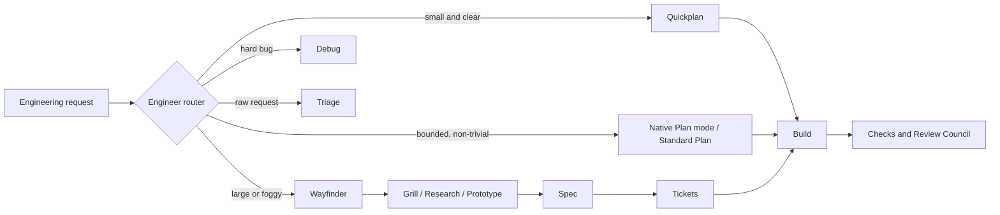

# Codex Engineering System

Three planning depths, one composable engineering flow for ChatGPT and Codex.

| Planning depth | ChatGPT desktop | Codex CLI / IDE | Use it for |
| --- | --- | --- | --- |
| Fast bounded plan | `@quickplan` | `$quickplan` | Small changes with clear requirements and architecture |
| Standard plan (`@plan` / `$plan` tier) | Native Plan control when available; otherwise `@standard-plan` | Native Plan mode when available; otherwise `$standard-plan` | Ordinary non-trivial features, refactors, and integrations |
| Deep decision map | `@wayfinder` | `$wayfinder` | Large, foggy, multi-session efforts with unresolved decisions |

Describe work normally and the `engineer` router can choose a workflow. Explicit skill mentions override routing.

> `@plan` and `$plan` are the mental label for the middle tier, not a portable skill selector. Current hosts may expose Plan as a collaboration mode instead. Use that native control when present; the guaranteed explicit fallback shipped here is `@standard-plan` / `$standard-plan`. The repository deliberately avoids a custom `plan` name that could collide with a host-provided selector.

## What this is

Codex Engineering System is a skills-only plugin and repo-scoped skill collection. It gives Codex a shared route from uncertainty to verified delivery:



The system defaults to local Markdown artifacts and existing repository tools. It requires no hosted tracker or MCP server. GitHub Issues can be used as an isolated tracker adapter when the user explicitly chooses it.

## Install

### Try the repository-scoped skills

Clone the reviewed source commit, open it in ChatGPT desktop or launch Codex from its root, and the `.agents/skills` compatibility link exposes the canonical packaged `skills/` tree for repository-scoped discovery.

```bash
git clone --no-checkout https://github.com/Mohammed-Moniem/codex-engineering-system.git
cd codex-engineering-system
git switch --detach 46e76b5fa305c580716a2c677621fda0d5ec6345
codex
```

The immutable commit above is the reviewed executable/package state for this release. Following the default branch is appropriate for development, but it is not a reproducible installation.

### Install one skill

Use the built-in installer and name the GitHub repository path you want. For example:

```text
$skill-installer Install the quickplan skill from
https://github.com/Mohammed-Moniem/codex-engineering-system/tree/46e76b5fa305c580716a2c677621fda0d5ec6345/skills/quickplan
```

Restart Codex only if the newly installed skill does not appear. The [official skill documentation](https://developers.openai.com/codex/build-skills) describes repository and user skill locations, explicit invocation, and installation from other repositories.

### Install the bundle as a plugin

This repository is a Git marketplace containing a skills-only plugin:

```bash
codex plugin marketplace add Mohammed-Moniem/codex-engineering-system --ref 46e76b5fa305c580716a2c677621fda0d5ec6345
codex plugin add codex-engineering-system@codex-engineering-system
```

Public one-click discovery still requires submission to the universal plugin directory; a GitHub repository alone is not a directory listing. See [installation details](docs/INSTALLATION.md) and the [official plugin documentation](https://developers.openai.com/plugins/build/plugins).

## Skills

`@name` is ChatGPT desktop syntax. `$name` is Codex CLI / IDE syntax.

| Skill | When to use | Tiny example | Expected output |
| --- | --- | --- | --- |
| `@engineer` / `$engineer` | Let the router choose the workflow | “Add team invitations” | Selected route and next artifact |
| `@quickplan` / `$quickplan` | Small, clear change | “Rename this API field” | Compact plan, assumptions, checks |
| Native Plan mode (`@plan` / `$plan` only if the host lists it) | Ordinary feature or refactor | “Add saved searches” | Native standard implementation plan |
| `@standard-plan` / `$standard-plan` | Portable standard-tier fallback | “Plan saved searches” | Complete ordered implementation plan |
| `@wayfinder` / `$wayfinder` | Large, uncertain effort | “Design offline sync” | Persistent decision map and frontier |
| `@grill` / `$grill` | One-session design choices | “Clarify account deletion” | Dependency-ordered human decisions |
| `@domain` / `$domain` | Domain vocabulary and durable rules | “Define order lifecycle terms” | Glossary, invariants, selective ADRs |
| `@research` / `$research` | Decision-relevant facts | “Compare queue guarantees” | Sourced conclusion and decision impact |
| `@prototype` / `$prototype` | Retire uncertainty with a spike | “Test the migration path” | Hypothesis, evidence, verdict |
| `@questionnaire` / `$questionnaire` | Knowledge lives with an SME | “Prepare billing questions” | Focused external-input questionnaire |
| `@wizard` / `$wizard` | Human-only setup or cutover | “Guide the DNS cutover” | Deterministic checked procedure |
| `@spec` / `$spec` | Decisions are resolved | “Write the implementation spec” | Decision-traceable specification |
| `@tickets` / `$tickets` | Spec is ready for delivery | “Slice this spec” | Demoable dependency-aware work items |
| `@build` / `$build` | Implement one bounded item | “Build ticket APP-12” | Code, checks, verification, review |
| `@tdd` / `$tdd` | Behavior is best driven at a seam | “TDD the retry policy” | Focused red/green/refactor loop |
| `@debug` / `$debug` | Bug or performance regression | “Intermittent upload failure” | Reproduction, tested hypotheses, fix |
| `@review-council` / `$review-council` | Review a change | “Review this branch” | Risk-ranked findings by review axis |
| `@architecture` / `$architecture` | Diagnose structural debt | “Find coupling hotspots” | Evidence-backed improvement candidates |
| `@triage` / `$triage` | Raw bug, feature, or PR | “Triage this report” | Agent-ready brief or clear disposition |
| `@resolve-conflicts` / `$resolve-conflicts` | Merge/rebase conflicts | “Resolve this rebase” | Intent-preserving resolution and checks |
| `@setup-boundaries` / `$setup-boundaries` | Optional TS import enforcement | “Enforce module boundaries” | Adapted rules with pass/fail/pass proof |
| `@handoff` / `$handoff` | Move work to another context | “Hand this effort off” | Concise redacted context pointer |
| `@agent-docs` / `$agent-docs` | Maintain agent instructions | “Update AGENTS.md” | Progressive, single-source agent docs |
| `@setup-engineering` / `$setup-engineering` | Adopt the system in a repo | “Set up these workflows” | Non-destructive project conventions |

## Wayfinder V2

Wayfinder starts with the destination and keeps a persistent shared map. It separates actionable frontier decisions from in-scope areas that are still too vague to phrase, records assumptions and invariants, and links evidence to the decisions it can change. Decision changes trigger dependency inspection and invalidation.

Independent AFK research, repository exploration, benchmarks, and experiments may run in parallel. Human-in-the-loop decisions remain with the human; the main context generally resolves one conceptual HITL branch at a time. Wayfinder exits only when the route can be executed without inventing another major decision, then hands substantial work to `spec`, `tickets`, and `build`.

See [the planning model](docs/PLANNING-MODEL.md) and the [Wayfinder map schema](skills/wayfinder/references/map-schema.md).

## Hooks

The plugin ships two optional, deterministic Codex hooks:

- `SessionStart` emits only a validated relative pointer to an active Wayfinder map on startup, resume, clear, or compact.
- `PreToolUse` parses structured Bash hook input and blocks selected destructive Git commands. It is a guardrail, not a complete security boundary.

Codex requires users to review and trust non-managed hooks. Read [hook behavior and limitations](docs/HOOKS.md) before enabling them.

## Validation

The repository uses Python's standard library for its runtime checks and tests:

```bash
python3 scripts/validate_repo.py
python3 -m unittest discover -s tests -v
python3 scripts/scan_secrets.py --all
```

The checks cover skill metadata, `agents/openai.yaml`, duplicate names, local links, routing fixtures, planning-depth fixtures, hook attacks and edge cases, unsafe repository content, GitHub workflow policy, and worktree plus Git-history secret patterns. See [evals and testing](docs/EVALS.md).

## Codex-first, with credit

This project uses current Codex conventions: packaged `skills/`, repository-scoped `.agents/skills`, `agents/openai.yaml`, `@skill` in ChatGPT desktop, `$skill` or `/skills` in Codex, and Codex lifecycle hooks.

It is inspired by the composable engineering skills and Wayfinder work in [mattpocock/skills](https://github.com/mattpocock/skills). That repository supports Codex and other agents; this project is an original Codex-first implementation, not a claim that the upstream work is Claude-only. See [NOTICE.md](NOTICE.md).

## Contributing and security

Read [CONTRIBUTING.md](CONTRIBUTING.md) before changing a workflow. Report vulnerabilities through GitHub private vulnerability reporting as described in [SECURITY.md](SECURITY.md). The project is licensed under [MIT](LICENSE).
