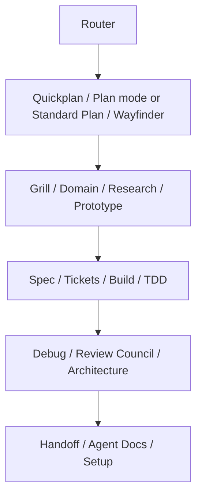

# Architecture

## Package shape

- `.agents/skills/` is the canonical skill source and the repository-scoped discovery location.
- `.codex-plugin/plugin.json` packages the same tree through an in-repository `skills` symlink, preserving `.agents/skills` as the only source of truth.
- `hooks/` contains optional deterministic lifecycle hooks discovered by Codex after user review and trust.
- `scripts/` contains repository validation and secret scanning, not workflow reasoning.
- `evals/` contains routing and skill behavior fixtures.

## Composition contract

The router selects a workflow but does not pretend to execute a specialist from memory. Each specialist is a self-contained skill with a clear input, workflow, stop condition, and output. Persistent artifacts link to their sources instead of copying them.

## State ownership

Project state belongs to the project, not the installed plugin. Wayfinder writes under `.codex/wayfinder/` in the target repository. The active pointer contains one validated project-relative path. Tracker adapters are kept behind a small contract; local Markdown is always available and remains the default.

## Security posture

- No runtime network dependency or package install.
- No secret or transcript persistence.
- Hook input is untrusted JSON.
- Pointer paths are bounded to the current Git repository and checked against traversal and symlink escape.
- Destructive command parsing is conservative and fails closed on malformed enforcement input.
- GitHub Actions run untrusted pull-request code with read-only repository permission and no write credentials.
